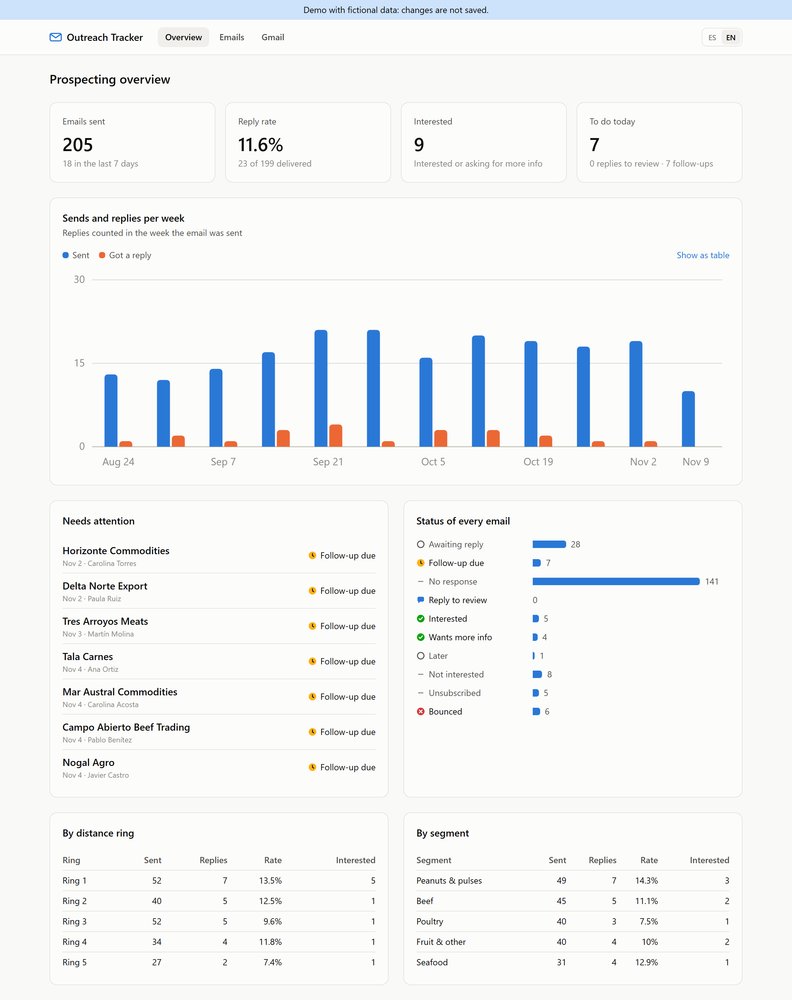
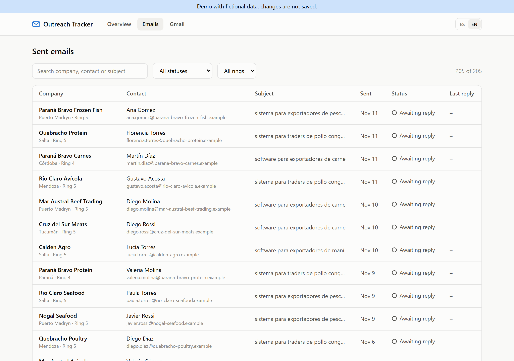
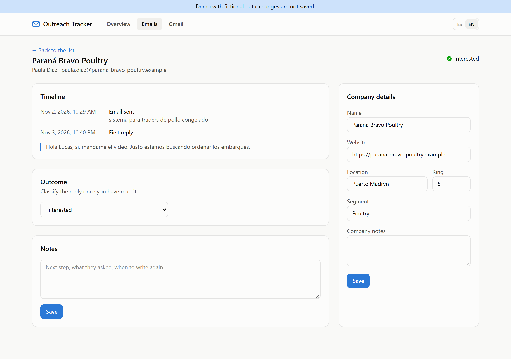

# Outreach Tracker

A small dashboard that tracks a cold-email prospecting campaign straight from Gmail: which companies were contacted, who replied, which follow-ups are due, and how each lead ended.

I built it to run my own daily outreach (five hand-written emails a day to food exporters in Argentina). Emails are drafted and sent from Gmail as usual; the tracker reads the threads, works out the state of each one, and gives me a single list of what to do today.

**Live demo:** _add your Vercel URL here_ (runs on generated, fictional data)



## Features

- **Gmail sync (read-only).** Pulls every thread that matches a Gmail search (by default a label) through the Gmail API with OAuth 2.0. It never sends or modifies email.
- **Automatic status per thread.** Detects human replies, out-of-office auto-replies and bounces, and runs a follow-up clock: one reminder after 7 days, then the thread is closed.
- **Outcome tracking.** Each reply is classified by hand (interested, wants more info, later, not interested, unsubscribed); the sync never overwrites it.
- **Dashboard.** Sends and replies per week, reply rate, a "to do today" list, status breakdown, and results by distance ring and by segment.
- **Company enrichment.** Company names are derived from the email domain; location, ring and segment can be edited.
- **Bilingual UI** (Spanish / English) and light / dark themes.
- **Public demo mode** that serves deterministic fictional data, so the project can be shown without exposing real prospects.

| Emails | Detail |
| --- | --- |
|  |  |

## Tech stack

- **Next.js 15** (App Router, React Server Components, Server Actions) and **TypeScript** in strict mode
- **Prisma** + **SQLite** for local storage
- **Gmail API** (`@googleapis/gmail`) with OAuth 2.0 and a CSRF-protected callback
- **Tailwind CSS 4**; charts are hand-written SVG with no chart library
- **Zod** for input and configuration validation
- **Vitest** for unit tests, **GitHub Actions** for CI (types, lint, tests, build)

## Architecture

```
Gmail API ──► gmail/sync.ts ──► parseThread()  (pure)  ──► Prisma / SQLite
                                                              │
UI (Server Components) ◄── Repository interface ◄─────────────┤
        │                    ├─ prismaRepository  (real data)  │
        │                    └─ demoRepository   (generated)   │
        └─► deriveStatus() / computeStats()  (pure, tested)
```

- `src/lib` holds the domain logic as pure functions (`deriveStatus`, `computeStats`, `parseThread`, `companyFromEmail`). It has no I/O and is fully unit-tested.
- `src/server/repository` is the storage boundary. The UI never knows whether it is reading SQLite or demo data.
- The sync only rewrites facts that come from Gmail (dates, reply counts, bounces). User decisions (outcome, notes, company details) are never touched.

## Getting started

Requirements: Node.js 20.9 or later.

```bash
npm install
npm run dev:demo        # demo data at http://localhost:3000
```

To track your own Gmail:

```bash
cp .env.example .env    # then fill in the Google credentials (see below)
npm run db:push         # creates prisma/dev.db
npm run dev             # open http://localhost:3000/settings and click "Connect Gmail"
```

### Gmail setup

1. In [Google Cloud Console](https://console.cloud.google.com/), create a project and enable the **Gmail API**.
2. Configure the **OAuth consent screen** (External, testing mode) and add your own Google account as a test user.
3. Create an **OAuth client ID** of type *Web application* with the redirect URI `http://localhost:3000/api/gmail/callback`.
4. Copy the client ID and secret into `.env`.
5. In Gmail, put the label `prospeccion` on the prospecting emails (or change `GMAIL_QUERY`; for a mailbox used only for outreach, `in:sent` is enough).

The app asks only for the `gmail.readonly` scope. The refresh token is stored in the local SQLite file.

### Scheduled sync

`npm run sync` runs the same sync from the command line, so it can be scheduled with Windows Task Scheduler or cron.

## Privacy and security

- Real data stays on your machine. `.env` and `prisma/dev.db` are git-ignored.
- Real mode has no login and is meant to run locally: a middleware rejects any request that is not addressed to `localhost`.
- Demo mode uses fictional companies on the reserved `.example` domain.

## Scripts

| Script | What it does |
| --- | --- |
| `npm run dev` / `npm run dev:demo` | Development server, real or demo data |
| `npm run build` / `npm start` | Production build and server |
| `npm test` | Unit tests (Vitest) |
| `npm run typecheck` / `npm run lint` | TypeScript and ESLint |
| `npm run db:push` | Create or update the SQLite schema |
| `npm run sync` | Sync Gmail from the command line |
| `npm run screenshots` | Regenerate the README screenshots from a running demo (uses local Chrome) |

## Deploying the demo

Import the repository in [Vercel](https://vercel.com/) and set the environment variable `DEMO_MODE=true`. No database or Google credentials are needed.

## License

MIT
